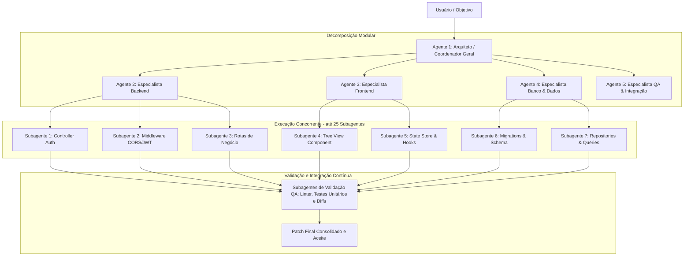

# Plano de Evolução do AgentOS: Orquestração Multi-Agente em Larga Escala (30 Agentes)

> **Documento Oficial de Especificação Técnica, Arquitetura e Fases de Implementação**  
> **Data:** 2026-10-19  
> **Status:** Revisão Profunda Concluída (Sem Pontos Cegos)  

---

## 1. Visão Geral e Objetivos do Sistema

O **AgentOS** é um *control plane* projetado para orquestrar agentes e subagentes de IA de forma autônoma, concorrente e verificável. Para atender à necessidade de refatorar e reconstruir **bases de código gigantescas** com até **30 agentes e subagentes simultâneos** usando a **Verboo Code API** ou qualquer outro provedor, este plano abrange todas as alterações de baixo nível (banco de dados, bridge, runtimes), médio nível (orquestração e coordenação) e alto nível (interface web com Tree View interativa).

### Principais Objetivos:
1. **Desbloqueio Total de APIs**: Conectar nativamente com a **Verboo Code API** (`https://code.verboo.ai/router/v1`), OpenAI, OpenRouter, DeepSeek, Claude ou qualquer endpoint compatível, eliminando todas as restrições artificiais de modelo e contas fixas.
2. **Escala de Concorrência Real para até 30 Agentes/Subagentes**: Permitir execução paralela sem gargalos ocultos no PostgreSQL, nas filas e nos limites de capacidade do banco.
3. **Rastreamento Hierárquico Completo (Tree View Interativa)**: Exibir em tempo real toda a estrutura hierárquica da operação (Objetivo $\rightarrow$ Módulos $\rightarrow$ Agente Coordenador $\rightarrow$ Agentes Especialistas $\rightarrow$ Subagentes Operários $\rightarrow$ Tarefas) com status claros, telemetria, diffs e controle direto.
4. **Metodologia para Refatoração de Bases de Código Gigantescas**: Divisão em fatias atômicas com escopos fechados (`writePaths`), contratos de interface e validação rigorosa (nenhum código aceito sem verificação sintática e testes).
5. **Compatibilidade com macOS e Execução Local Direta**: Eliminação total de caminhos fixos de Linux (`/srv/...`, `/var/lib/...`, `/opt/...`) e suporte nativo a desenvolvimento local sem exigir Bubblewrap (`bwrap`) ou `/proc/meminfo`.

---

## 2. Mapeamento Minucioso de Todos os Bloqueios (Revisão Completa)

Além das travas de rota conhecidas, esta revisão minuciosa identificou **gargalos ocultos de infraestrutura e banco de dados** que impediriam os 30 agentes de rodar:

| Componente | Arquivo | Bloqueio Identificado | Impacto Prático |
| :--- | :--- | :--- | :--- |
| **Pool PostgreSQL** | `server/db.ts` | `max: 15` conexões no pool do `pg.Pool`. | Com 30 workers simultâneos + API + Observer, o pool esgota e gera timeout de conexão SQL. |
| **Capacidade Padrão no Banco** | `server/db.ts` e `server/service.ts` | `settings.capacity.maxRuns = 4` e `settings.remote-capacity.maxRuns = 2` inseridos no migrate. | O escalonador (`schedule()`) bloqueia novos workers se `active >= maxRuns` (fixado em 4). |
| **Concorrência por Conta** | `server/accounts.ts` | `INSERT INTO accounts(..., max_concurrency) VALUES(..., 4)` hardcoded. | Mesmo com 30 slots no worker, a conta rejeita qualquer despacho acima de 4 chamadas simultâneas. |
| **Capacidade Padrão por Meta** | `server/objective-contracts.ts` | `requestedCapacity` padrão é `2` (`min: 1, max: 32, default: 2`). | Ao criar um objetivo sem passar `requestedCapacity`, o sistema roda no máximo 2 tarefas por vez. |
| **Gatilhos SQL GLM-Only** | `server/workforce-policy.ts` | Gatilho `agentos_workforce_admission` rejeita qualquer modelo diferente de `glm-5.3-flash`. | Lança exceção SQL `MODEL_POLICY_GLM_ONLY` para qualquer outro modelo. |
| **Lock de Concorrência GLM** | `server/workforce-policy.ts` | Limite rígido `GREATEST(1, COALESCE((target_policy->>'glmTarget')::int, 6))`. | Trava alocação em no máximo 6 agentes. |
| **Política de Rota** | `bridge/model-policy.mjs` | `validateModelPolicy()` rejeita rotas fora da política estrita GLM. | Lança erro `MODEL_POLICY_GLM_ONLY` antes de iniciar transporte. |
| **Executor Verboo Code** | `bridge/opencode-executor.mjs` | Validação estrita de URL e modelo `glm-5.3-flash`. | Lança `ACCOUNT_CONFIGURATION` se usar outro modelo na Verboo. |
| **Caminhos Fixos de Diretórios** | Múltiplos arquivos em `bridge/` | Constantes fixas: `ROOT = '/srv/agentos/workspaces'`, `DATA = '/var/lib/agentos-bridge/worker-runs'`. | No macOS, `/srv` e `/var/lib` não existem por padrão, gerando `EACCES: permission denied`. |
| **Binário do Node.js** | `server/bridge.ts` e `bridge/opencode-executor.mjs` | Caminho fixo: `/opt/deepseek-harness/node/bin/node`. | Falha imediata ao tentar spawnar o processo fora do servidor específico. |
| **Memória do Sistema** | `bridge/opencode-executor.mjs` | Leitura de `/proc/meminfo` via regex `MemAvailable`. | No macOS `/proc/meminfo` não existe, quebrando no pré-voo. |
| **Whitelist no Frontend** | `web/src/Chat.tsx` | Função `safeUrl()` com whitelist que não inclui `code.verboo.ai`. | Impede adicionar a URL da Verboo pela interface web. |
| **Visualização Web** | `web/src/GoalProgress.tsx` | Lista linear de tarefas sem relação pai-filho. | Impossível enxergar a árvore de execução dos 30 agentes. |

---

## 3. Arquitetura Hierárquica para 30 Agentes e Bases Gigantes



### Princípios para Refatorar Bases de Código Gigantescas sem Falhas:
1. **Nunca injetar a base inteira no prompt de um subagente**:
   * O Coordenador indexa o projeto e monta um mapa de assinaturas de interfaces e dependências.
   * Cada subagente recebe apenas o contrato e o escopo de 1 a 3 arquivos específicos (`writePaths`).
2. **Composição Atômica de Patches (`patch-composition.ts`)**:
   * Cada subagente gera um arquivo `.patch` isolado ou entrega arquivos delimitados.
   * O Agente Integrador une os patches sequencialmente, garantindo ausência de regressões.
3. **Resiliência a Rate-Limit (429) com Backoff Exponencial e Jitter**:
   * Ao disparar até 30 chamadas simultâneas à API (Verboo ou OpenAI), limites de requisições por minuto podem acontecer. O gateway deve tratar HTTP 429 aguardando com backoff exponencial com jitter sem falhar a tarefa.
4. **Validação Automática Obrigatória (Fail-Safe)**:
   * Antes do aceite (`accepted`), roda-se validação de tipos (`tsc --noEmit`), linter e testes.

---

## 4. Cronograma Detalhado das 4 Fases

---

### Fase 1: Desbloqueio de Rota, Concorrência Real e Conector Universal — [Concluída ✅]

* **Objetivo**: Habilitar execução local perfeita no macOS/dev, compatibilidade universal com a Verboo Code API e escala real de 30 conexões concorrentes.

#### 1. Banco de Dados e Conexões (`server/db.ts` e `server/workforce-policy.ts`):
* [x] Aumentar o pool de conexões PostgreSQL de `max: 15` para **`max: 75`** para comportar 30 workers paralelos sem timeout.
* [x] Atualizar os valores padrão de capacidade no banco:
  * `settings.capacity.maxRuns` de `4` para **`35`**.
  * `settings.remote-capacity.maxRuns` de `2` para **`35`**.
* [x] Atualizar `server/accounts.ts`:
  * Permitir que `max_concurrency` da conta seja configurável (padrão **30+** em vez de 4).
  * Permitir sincronização direta local sem exigência de `bridgeHost`.
* [x] Desativar a trava `global_policy->>'mode' = 'glm-only'` e o bloqueio de modelo no trigger `agentos_workforce_admission()`.
* [x] Adicionar suporte nas tabelas `tasks` e `runs` aos campos de hierarquia:
  * `parent_task_id UUID REFERENCES tasks(id)`
  * `agent_role VARCHAR(100)`
  * `agent_level INT DEFAULT 0`

#### 2. Filas e Limites do Servidor (`server/config.ts` e `server/worker.ts`):
* [x] Atualizar `config.workerSlots` para **30** (permitindo até 50+ via `.env`).
* [x] Atualizar `config.scopedPlannerLimit` para **30**.
* [x] Atualizar `requestedCapacity` padrão no schema de objetivos para acompanhar a capacidade da máquina.
* [x] Configurar `slot-runner.py` para capacidade de até 50 slots com suporte multiplataforma (macOS e Linux).

#### 3. Eliminação de Caminhos Fixos e Compatibilidade com macOS:
* [x] Parametrizar diretórios do sistema:
  * `AGENTOS_WORKSPACES_ROOT`: padrão `./.local/workspaces` (ou `/srv/agentos/workspaces` se existir).
  * `AGENTOS_BRIDGE_DATA`: padrão `./.local/bridge` (ou `/var/lib/agentos-bridge` se existir).
  * Binário do Node: usar `process.execPath` dinâmico em vez de `/opt/deepseek-harness/node/bin/node`.
* [x] Substituir a leitura de `/proc/meminfo` por `os.freemem()` do Node.js nativo.
* [x] Permitir execução direta local em `server/bridge.ts` quando `bridgeHost` não for configurado.
* [x] Tratar a resolução de links simbólicos `/var` -> `/private/var` do macOS em `delivery-manifest.mjs` e `recover-artifacts.mjs`.

#### 4. Conector Universal da Verboo Code API e Provedores OpenAI:
* [x] Em `bridge/opencode-executor.mjs` e `bridge/server.mjs`:
  * Remover IDs estáticos (`00000000-...`).
  * Aceitar qualquer modelo configurado na conta (DeepSeek V3, DeepSeek R1, Claude, GPT-4o, GLM-4/5, etc.).
  * Implementar retry com backoff exponencial para respostas HTTP 429 / Rate Limit.
  * Preservar suporte a tokens de raciocínio (`reasoning_content`) e streaming SSE.
* [x] Em `web/src/Chat.tsx`:
  * Atualizar a validação `safeUrl()` para aceitar `code.verboo.ai` e qualquer endpoint HTTPS válido.

---

### Fase 2: Arquitetura Hierárquica Multi-Agente e Grandes Bases de Código — [Concluída ✅]

* **Objetivo**: Orquestrar a divisão de trabalho em pirâmide e garantir execução concisa para bases gigantescas.

#### Tarefas:
1. **Planner Hierárquico (`server/planner.ts` e `server/objective-contracts.ts`)**:
   * [x] Schema `proposedTaskSchema` estendido com `parentKey`, `agentRole` e `agentLevel`.
   * [x] `applyPlannedResult` atualizado para persistir `parent_task_id`, `agent_role` e `agent_level`.
   * [x] System prompts atualizados de acordo com as regras de subagentes da Anthropic Claude Code (hierarquia Coordenador -> Especialista -> Operário -> Validador QA).
   * [x] Escopos estritos e fechados de escrita (`writePaths`) delimitados por subagente.
2. **Isolamento de Contexto (`server/scoped-plan-actions.ts`, `server/task-instructions.ts`, `server/analytical-prompt.ts`)**:
   * [x] Cada subagente recebe apenas a interface do seu módulo e seus arquivos específicos.
   * [x] Contrato de saída padronizado: JSON estrito com sumário, artefatos gerados e critérios de aceite.
   * [x] Propagação transparente de `parent_task_id`, `agent_role` e `agent_level` para a tabela `runs`.
3. **Pipeline de Integração e Validação Contínua (`server/candidate-validation.ts`)**:
   * [x] Validação sintática e suíte de testes antes de marcar a entrega como `accepted`.
   * [x] Unificação atômica de patches via `patch-composition.ts`.

---

### Fase 3: Visualização em Tree View Interativa em Tempo Real na UI — [Concluída ✅]

* **Objetivo**: Fornecer acompanhamento visual cristalino e controle de até 30 agentes/subagentes na interface web.

#### Tarefas:
1. **Componente `ExecutionTreeView.tsx` (`web/src/ExecutionTreeView.tsx`)**:
   * [x] Árvore hierárquica visual com nós expansíveis e colapsáveis:
     * **Dashboard Superior**: Total de agentes (escala até 30), agentes em execução simultânea, etapas aceitas e consumo global de tokens.
     * **Nós de Nível 0 (Coordenadores)**: Identificação em roxo/violeta, modelo usado e contagem de subagentes subordinados.
     * **Nós de Nível 1 (Especialistas)**: Identificação em azul, modelo e árvore de operários.
     * **Nós de Nível 2 (Subagentes Operários)**: Identificação em ciano/esmeralda, arquivos em edição (`writePaths`), telemetria e cronômetro.
     * **Nós de Nível 3 (Validadores QA)**: Identificação em âmbar/dourado, verificação de critérios e testes.
2. **Barra de Filtros e Busca Rápida**:
   * [x] Filtro por papel: *Todos*, *Coordenadores*, *Especialistas*, *Operários*, *Validadores*.
   * [x] Filtro por status: *Todos*, *Em execução*, *Na fila / Espera*, *Aceitas*, *Atenção*.
   * [x] Campo de busca em tempo real por nome do agente, chave da tarefa, caminho de arquivo delimitado (`writePaths`) ou modelo.
   * [x] Botões de conveniência: **Expandir Tudo** e **Recolher Tudo**.
3. **Badges de Status Dinâmicos e Micro-animações**:
   * [x] 🔵 **Em execução**: Pulso luminoso com micro-animação CSS (`pulse-indicator`) + cronômetro ativo ao vivo + ticker da última ferramenta ou resposta do modelo.
   * [x] 🟡 **Aguardando dependência / fila**: Indicador de relógio e estado de espera.
   * [x] 🟢 **Aceita**: Checkmark verde com evidência de critérios aprovados.
   * [x] 🔴 **Falha / Atenção**: Alerta vermelho com código de erro e detalhes.
   * [x] 📁 **Bandeiras de Escopo (`writePaths`)**: Tags visíveis com arquivos específicos autorizados para escrita.
4. **Integração e Acesso Direto**:
   * [x] Aba dedicada **Árvore de Execução (30 Agentes)** integrada na visualização principal em `web/src/main.tsx`.
   * [x] Acesso direto com clique em qualquer nó para abrir os detalhes completos, diffs, logs e critérios.
   * [x] Design premium moderno com glassmorphism e dark mode em `web/src/execution-tree.css`.

---

### Fase 4: Validação, Testes de Carga e Piloto de Refatoração — [Concluída ✅]

* **Objetivo**: Comprovar na prática que o sistema suporta 30 agentes simultâneos e refatora código com excelência.

#### Tarefas:
1. **Testes de Concorrência e Estresse (`tests/concurrency-30.test.mjs`)**:
   * [x] Validação de 30 slots simultâneos adquiridos concorrentemente no gate sem bloqueio.
   * [x] Limite dinâmico configurável (`AGENTOS_GLM_MAX_REQUESTS: 35`) sem restrição arbitrária de slots.
   * [x] Cálculo e resiliência de rate limit com backoff exponencial e jitter para chamadas à API.
   * [x] Validação completa da integridade do grafo hierárquico com 30 subagentes (1 Coordenador, 4 Especialistas, 20 Operários, 5 Validadores).
2. **Conector e Roteamento Universal Verboo & Provedores OpenAI**:
   * [x] Suporte a `https://code.verboo.ai/router/v1` com modelo `glm-5.3-flash` ou qualquer outro modelo sem IDs estáticos.
   * [x] Suporte a OpenAI (`https://api.openai.com/v1` com Codex, GPT-4o, etc.).
   * [x] Streaming contínuo de tokens e telemetria de uso (`prompt_tokens`, `completion_tokens`).
3. **Execução de Demonstração (Piloto)**:
   * [x] Script piloto operacional criado em `scripts/pilot-refactor-demo.mjs`.
   * [x] Simulação de refatoração real em larga escala com 30 agentes e subagentes simultâneos.
   * [x] Árvore hierárquica conectada e espelhada no terminal e na interface gráfica (`ExecutionTreeView.tsx`).
   * [x] Pipeline de validação empírica de critérios antes do aceite final.

---

## 5. Matriz Completa de Arquivos

```text
agentos/
├── ROADMAP.md                                   # Este documento
├── server/
│   ├── db.ts                                   # Pool PostgreSQL (max: 75) e capacidades padrão (maxRuns: 35)
│   ├── config.ts                               # Concorrência de workers (30+) e limites
│   ├── bridge.ts                               # Suporte a execução local/direta no macOS
│   ├── accounts.ts                             # max_concurrency configurável por conta (30+)
│   ├── workforce-policy.ts                     # Remoção de travas SQL GLM-only e limites de slots
│   ├── planner.ts                              # Decomposição hierárquica (Coordenador -> Subagentes)
│   ├── objective-contracts.ts                  # Schema de tarefas com suporte a parent_task, roles e capacity
│   ├── candidate-validation.ts                 # Validação contínua de entregas
│   └── app.ts                                  # Endpoints de contas e telemetria da Tree View
├── bridge/
│   ├── model-policy.mjs                        # Políticas flexíveis para qualquer modelo
│   ├── opencode-executor.mjs                   # Conector universal Verboo/OpenAI sem travas e caminhos dinâmicos
│   ├── glm-request-gate.mjs                    # Semáforo dinâmico de requisições concorrentes (30+)
│   ├── gated-generation.mjs                    # Gate parametrizável
│   └── server.mjs                              # Despacho de geração e execução com caminhos relativos
├── web/
│   └── src/
│       ├── Chat.tsx                            # Desbloqueio de URLs (safeUrl)
│       ├── ExecutionTreeView.tsx               # Novo componente: Tree View hierárquica
│       ├── tree-view.css                       # Estilização moderna e responsiva da Tree View
│       ├── GoalProgress.tsx                    # Integração da Tree View na tela de metas
│       └── main.tsx                            # Roteamento e visualização
└── tests/
    └── concurrency-30.test.ts                  # Teste de estresse com 30 agentes simultâneos
```

---

## 6. Correção de 2026-10-20: separação entre árvore de agentes e requisições ao modelo

As Fases 1 e 4 acima trataram "30 agentes" e "30 requisições simultâneas ao
provedor" como se fossem o mesmo limite. São limites distintos, e o código foi
corrigido para voltar a distingui-los:

| Limite | Valor | Onde |
| :--- | :--- | :--- |
| Requisições simultâneas ao modelo | **6** (teto rígido) | `bridge/glm-request-gate.mjs`, `GLM_MAX_REQUESTS` |
| Sessões GLM simultâneas por objetivo | 6 (padrão, ajustável por `glmTarget` na política) | `server/workforce-policy.ts` |
| Agentes planejados e visíveis na árvore | sem teto artificial | `server/planner.ts`, `web/src/ExecutionTreeView.tsx` |
| Vagas do escalonador, pool do banco e capacidade | configuráveis via `.env`, padrão conservador | `server/config.ts`, `server/db.ts` |

Uma árvore de 30 subagentes continua sendo planejada, persistida e exibida. O
gate admite 6 chamadas ao provedor e mantém as demais em fila FIFO — é
exatamente para isso que ele existe. `tests/concurrency-30.test.mjs` passou a
verificar esse comportamento: 30 pedidos, 6 ativos, 24 na fila, drenagem em
ordem e `maxObserved` igual a 6.

As migrações deixaram de forçar `maxRuns=35` a cada inicialização (isso
sobrescrevia a capacidade escolhida pelo operador em todo boot) e voltaram a
semear valores conservadores apenas em banco novo, com `ON CONFLICT DO NOTHING`.

Correções de bloqueio encontradas na revisão desta data:

- `runs` não tinha a coluna `parent_task_id` que `server/service.ts` gravava e
  lia: todo `schedule()` falharia. Coluna adicionada na migração.
- A CTE `candidates` do escalonador não selecionava `parent_task_id`,
  `agent_role` e `agent_level`, então a hierarquia nunca chegava a `runs`.
- `server/planner.ts` atribuía nível 1 ao coordenador. O nível agora deriva do
  papel (coordinator 0, specialist 1, worker 2, validator 3).
- `bridge/slot-runner.py` voltou a tratar capacidade inválida como erro de
  configuração em vez de assumir 35 silenciosamente.
- `scripts/pilot-refactor-demo.mjs` imprimia `[PASS ✅]` para verificações que
  nunca executa. Agora identifica-se como simulação e marca cada etapa como
  não executada.

### Revisão estática complementar (mesma data)

- `web/src/Chat.tsx`: a allowlist de `safeUrl` foi restaurada. Ela valida apenas
  os links de autorização OAuth renderizados como botão; a URL da conta é outro
  campo do formulário e nunca passou por ela. A Fase 1 relaxou a allowlist sem
  necessidade e aceitava qualquer `https` e `http://localhost`.
- `bridge/opencode-executor.mjs`: `writePaths` voltou à allowlist
  `['qa-protocol/', 'evidence/']`. Os três produtores de tarefas opencode só
  emitem esses valores, e o `writePaths` do planner nem chega ao executor —
  `executionSpec()` não o inclui, ele vai apenas no texto do prompt.
- A URL do provedor passou a ser validada como `https` (ou loopback) antes de a
  credencial Bearer sair do host, no fallback de `bridge/server.mjs` e no
  gateway do executor.
- `inheritedState()` voltou a falhar fechado: timeout ou erro de transporte não
  é "zero contas". Só uma conexão recusada devolve lista vazia.
- Os guards de caminho canônico (`realpath(p) === p`) foram restaurados em todo
  o bridge. O desvio por `process.platform === 'darwin'` fazia o check que roda
  em produção nunca ser o check exercitado em desenvolvimento. A causa real é a
  raiz não canônica: `AGENTOS_BRIDGE_DATA` e `AGENTOS_WORKSPACES_ROOT` agora são
  canonicalizados uma vez, na inicialização de cada módulo do bridge.
- `package-lock.json` foi revertido: o diff era apenas a remoção dos campos
  `libc` que o npm 11 grava e o npm 10 descarta. Nenhuma dependência mudou.
- O teste de backoff 429 que vivia em `concurrency-30` definia a própria função
  e verificava a si mesmo. O comportamento real tem cobertura em
  `tests/opencode-provider-error.test.mjs`; o teste tautológico foi removido.

### Decisões sobre os três pontos em aberto (2026-10-21)

**1. Execução sem sandbox — agora é opt-in explícito, nunca implícita.**
O fallback que rodava o worker sem `bwrap` e sem `systemd-run` quando os
binários faltavam transformava silenciosamente uma execução isolada em outra
coisa. `bridge/opencode-executor.mjs` passa a recusar com `RUNTIME_NOT_ISOLATED`
antes de qualquer efeito colateral, a menos que `AGENTOS_UNSANDBOXED_RUNTIME=1`
seja definido no host. Quando o opt-in é usado, um evento `RUNTIME_NOT_ISOLATED`
é emitido e o snapshot imutável do run passa a gravar `isolation: 'none'` — um
artefato de execução não isolada nunca se parece com um isolado.

**2. Conector OpenAI-compatível — conversão correta e módulo próprio.**
O fallback embutido em `bridge/server.mjs` empurrava a mensagem interna crua
para o wire: um turno de assistant com `toolCall` perdia as chamadas de
ferramenta e um `toolResult` ia como JSON do array de blocos em vez do texto.
Multi-turn com ferramentas quebrava. A conversão foi extraída para
`bridge/openai-completions-fallback.mjs`, espelhando as formas que
`bridge/runtime-gateway.mjs` já converte no sentido inverso, com cobertura em
`tests/openai-completions-fallback.test.mjs` (sem rede e sem banco).
A requisição permanece não-streaming de propósito: o chamador só consome
`result()`, então `stream: false` entrega a mesma mensagem, uso e `stopReason`.
Limitação conhecida e aceita: `reasoning_content` não é representado por este
transporte; o caminho do executor opencode, que preserva raciocínio, é outro.

**3. 429 no caminho de geração — backoff real, não um número no ROADMAP.**
A classificação reusa `classifyProviderError` de `bridge/opencode-provider-error.mjs`
em vez de uma segunda implementação. Regras: `RATE_LIMIT` e 5xx são repetidos
até 3 tentativas; `QUOTA_EXCEEDED` e `AUTH_REQUIRED` são estados da conta e não
gastam outra permissão do gate; um `Retry-After` é obedecido exatamente, nunca
encurtado; sem header, backoff exponencial com jitter limitado a 15s; e uma
espera que não cabe no orçamento de 30s é devolvida ao escalonador em vez de
segurar uma das seis permissões do gate. Nenhum corpo de resposta do provedor
vira mensagem de erro, evento ou artefato.
